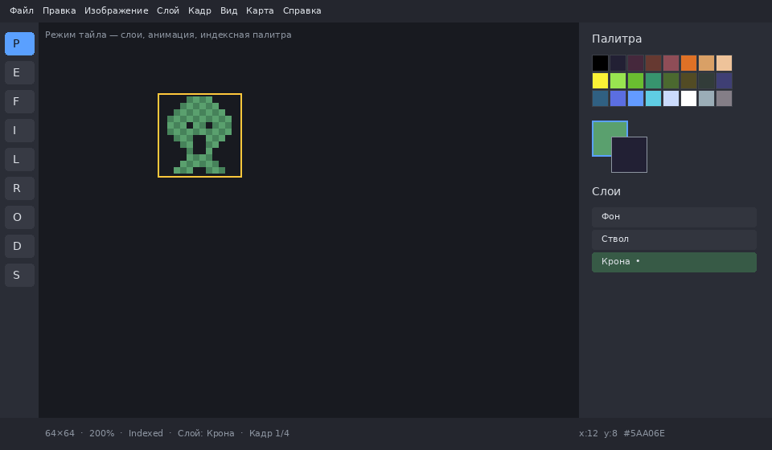
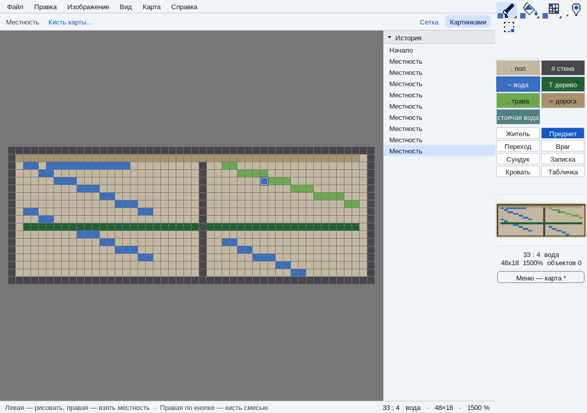

# True Joint Tile Maker

Редактор пиксельной графики, анимации и карт локаций.

Два режима в одном окне:

- **тайл** — рисование, слои, кадры, анимация, индексная палитра;
- **карта** — локации игры [Andors-Love](https://github.com/dpsmpx/Andors-Love)
  в формате `data/maps/*.map`.

Документы живут одновременно: переключение (`Tab`) ничего не теряет.





## Статус

**Версия 2.0.2 — план выполнен.**

Перенос с PascalABC.NET 0.6.0 на C++/SDL3, весь `RoadToProLevel` и полный
план интерфейса (этапы A–D аудита UX) закрыты. Подробности — в
[docs/roadmap.md](docs/roadmap.md).

Готовые сборки:

| Платформа | Архив |
| --- | --- |
| **Windows x64** | [TrueJointTileMaker-2.0.2-windows-x64.zip](https://github.com/dpsmpx/TrueJointTileMaker/releases/download/v2.0.2/TrueJointTileMaker-2.0.2-windows-x64.zip) |
| **Linux x86-64** | [TrueJointTileMaker-2.0.2-linux-x86_64.tar.gz](https://github.com/dpsmpx/TrueJointTileMaker/releases/download/v2.0.2/TrueJointTileMaker-2.0.2-linux-x86_64.tar.gz) |

Распакуйте и запустите `tjtm` / `tjtm.exe`. Рядом должны лежать `Resources/`,
`Картинки/` и `Config.txt` (они уже в архиве).

Все релизы: [Releases](https://github.com/dpsmpx/TrueJointTileMaker/releases).

## Что умеет 2.0

1. Выделение любой формы, трансформации, пиксель-перфект, узоры, оси симметрии
2. Палитра до 256 цветов, настоящий indexed mode, ряды, сдвиг тона, GPL/HEX/PAL
3. Проект `.tjt` — обычный PNG с проектом внутри
4. Слои, кадры, лента, луковая кожа, метки анимации, GIF и APNG, лист спрайтов
5. Линейки и направляющие, поворот на любой угол (RotSprite), BMP/TIFF
6. Группы слоёв, векторные слои, слой-тайлкарта
7. Связь с игрой: лист 8×8, атлас набора, карта с картинками тайлов и стыками
8. Фильтры, уровни, аэрограф, плавные преобразования (с пометкой «не пиксель-арт»)
9. Кисть из выделения, затенение по ряду палитры, градиент Байера, слой-образец
10. Редактор карт: объекты формой, кисть смесью местностей, поиск и замена
11–14. Полный современный интерфейс: меню, панели, темы, английский, нажим пера,
    настраиваемые клавиши, стартовый экран, справка с поиском

**English.** Switch the interface to English in Settings → Language
(or `Language = english` in `Config.txt`). Built-in help is translated.

## Сборка из исходников

```bash
tools/setup-env.sh                                   # Ubuntu 24.04
cmake --preset release && cmake --build --preset release
build/release/tjtm
```

Нужны CMake ≥ 3.24, Ninja, компилятор C++20. SDL3, SDL3_ttf и SDL3_image
скачиваются и собираются статически, если их нет в системе.

Сборка Windows — пресет `mingw` (MinGW-w64).

```bash
cmake --preset mingw -DBUILD_TESTING=OFF
cmake --build --preset mingw --target tjtm
```

Рядом с программой — `Config.txt`, `Resources/`, `Картинки/`.

## Управление (кратко)

| Мышь | Действие |
| --- | --- |
| Левая | применяет (рисует, ставит, нажимает) |
| Правая | берёт (пипетка, убирает объект) |
| Ролик + протяжка | двигает холст |
| Пробел + протяжка | рука |

| Клавиша | Действие |
| --- | --- |
| `Tab` | тайл ↔ карта |
| `F1` / `?` | шпаргалка клавиш |
| `Ctrl+K` | поиск команд |
| `Shift+Tab` | базовый / полный интерфейс |
| `F11` | во весь экран |
| `Ctrl+N` / `O` / `S` | создать / открыть / сохранить |
| `Z` / `Y` | отмена / повтор |
| `J` | лента слоёв и кадров |
| `H` | справка |

Полный список и настройка — «Справка → Настроить клавиши». Набор «как в Aseprite»
доступен там же.

## Документация

| Файл | Содержание |
| --- | --- |
| [docs/roadmap.md](docs/roadmap.md) | что сделано из плана, как устроено |
| [docs/fixes.md](docs/fixes.md) | намеренные расхождения с оригиналом 0.6.0 |
| [docs/porting.md](docs/porting.md) | как устроен перенос и сверка |
| [docs/ui-ux-audit.md](docs/ui-ux-audit.md) | аудит интерфейса (исходный план UX) |
| [docs/ui-design-system.md](docs/ui-design-system.md) | дизайн-система |
| [CLAUDE.md](CLAUDE.md) | правила для агентов и разработчиков |

Оригинал 0.6.0 на PascalABC.NET лежит в [`pascal/`](pascal/) и служит эталоном.
Ключ `--classic` возвращает жесты и облик оригинала для сверки.

## Разработка

```bash
cmake --preset debug && cmake --build --preset debug
ctest --preset debug
tools/lint.sh
```

Сценарии сверки экранов: `tools/screens.sh tests/screens/...`.
Эталоны новых возможностей: `tools/port-golden.sh`.

CI и выпуск запускаются вручную (workflow **Выпуск** / **CI**).

## Лицензия

GNU General Public License v3 — см. [LICENSE](LICENSE).

## Благодарности

Автор — dpsmpx.

PascalABC.NET — язык, среда и GraphABC.
Andors-Love — формат карт.
[Kerrie Lake / Resurrect 64](https://lospec.com/palette-list/resurrect-64) — палитра по умолчанию.
